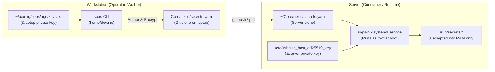

# 🔐 Secrets Management & Homelab GitOps Workflow

This document explains the secrets architecture for the workstation (`laptop`) and provides step-by-step operator workflows for managing homelab secrets in [`Core`](file:///home/kiskaadee/Projects/active/homelab/Core).

---

## 1. Secrets Architecture: Author vs. Consumer

A core architectural principle of this infrastructure is the separation between **Secret Authoring** and **Secret Consumption**:



### Two-Tier Secrets Architecture

The infrastructure enforces a strict separation between **Operator Secrets** (workstation) and **Runtime Workload Secrets** (server):

| Attribute | Workstation Operator Secrets (`Config`) | Server Runtime Secrets (`Core`) |
| :--- | :--- | :--- |
| **Ciphertext File** | `Config/secrets.yaml` | `Core/nixos/secrets.yaml` |
| **Scope** | Personal operator tokens (Cloudflare, Hostinger, GitHub) | Service runtime credentials (Traefik, DBs, Docker daemons) |
| **Tenancy** | Multi-project across account domains | Scoped strictly to homelab infrastructure workloads |
| **Decryption Model** | In-memory on-demand via `sops -d --extract` in shell wrappers | Automated boot-time ramfs mount via `sops-nix` (`/run/secrets/`) |
| **Key Identity** | Personal age identity (`~/.config/sops/age/keys.txt`) | Server host SSH key (`/etc/ssh/ssh_host_ed25519_key`) |
| **Daemon Overhead** | **Zero** (`sops-nix` module intentionally omitted) | Managed via root systemd units |

---

## 2. Workstation Operator Secrets (`Config/secrets.yaml`)

Operator CLI tools (such as `flarectl` and `hostinger`) manage cloud infrastructure across multiple projects. To maintain least-privilege for the server, these credentials are kept on the workstation:

```yaml
# Config/secrets.yaml (encrypted with operator age key)
cloudflare:
  api_token: "..."
  account_id: "..."

hostinger:
  api_token: "..."
```

### Process-Scoped In-Memory Decryption
Rather than exporting tokens into global interactive shells or writing plaintext config files to disk, shell wrappers in `home/shell/secrets.sh` extract credentials into the child process environment on demand:

```bash
# Example: flarectl wrapper in home/shell/secrets.sh
flarectl() {
    local secrets_file="$HOME/Config/secrets.yaml"
    if [[ -f "$secrets_file" ]] && command -v sops >/dev/null 2>&1; then
        CF_API_TOKEN=$(sops -d --extract '["cloudflare"]["api_token"]' "$secrets_file" 2>/dev/null) \
        CF_ACCOUNT_ID=$(sops -d --extract '["cloudflare"]["account_id"]' "$secrets_file" 2>/dev/null) \
        command flarectl "$@"
    else
        command flarectl "$@"
    fi
}
```

* **Security**: Decryption occurs strictly in RAM (~17ms overhead).
* **Isolation**: The environment variables exist only for the life of `flarectl "$@"` and do not persist in the parent interactive shell.

---

## 3. Homelab Server Runtime Secrets (`Core/nixos/secrets.yaml`)

To rotate or add a secret for homelab services:

### Step 1: Open Ciphertext Locally on Workstation
```bash
cd ~/Projects/active/homelab/Core/nixos
sops secrets.yaml
```

SOPS detects your personal identity in `~/.config/sops/age/keys.txt`, decrypts the file in memory, and opens your default editor (`$EDITOR` / Neovim).

### Step 2: Make Changes and Save
Edit values as necessary. Upon exiting the editor, SOPS encrypts new values using the public keys defined in `Core/.sops.yaml`.

### Step 3: Commit and Push
```bash
git add secrets.yaml
git commit -m "sec(core): rotate service credentials"
git push origin main
```

### Step 4: Rebuild Server
```bash
ssh server-remote "cd ~/Core && git pull && sudo nixos-rebuild switch --flake .#server"
```
The server evaluates the new ciphertext, decrypts it into `/run/secrets/`, and restarts affected systemd and Docker containers.

---

## 4. Backing Up & Restoring the Operator Age Key

The operator key is your cryptographic identity for managing homelab infrastructure:

```bash
# Location:
~/.config/sops/age/keys.txt

# File format:
# public key: age1...
AGE-SECRET-KEY-1...
```

Store this key securely in a password manager (e.g. Bitwarden/Vaultwarden). If re-installing the workstation, restore this file with mode `0600` before editing `Core` secrets.
